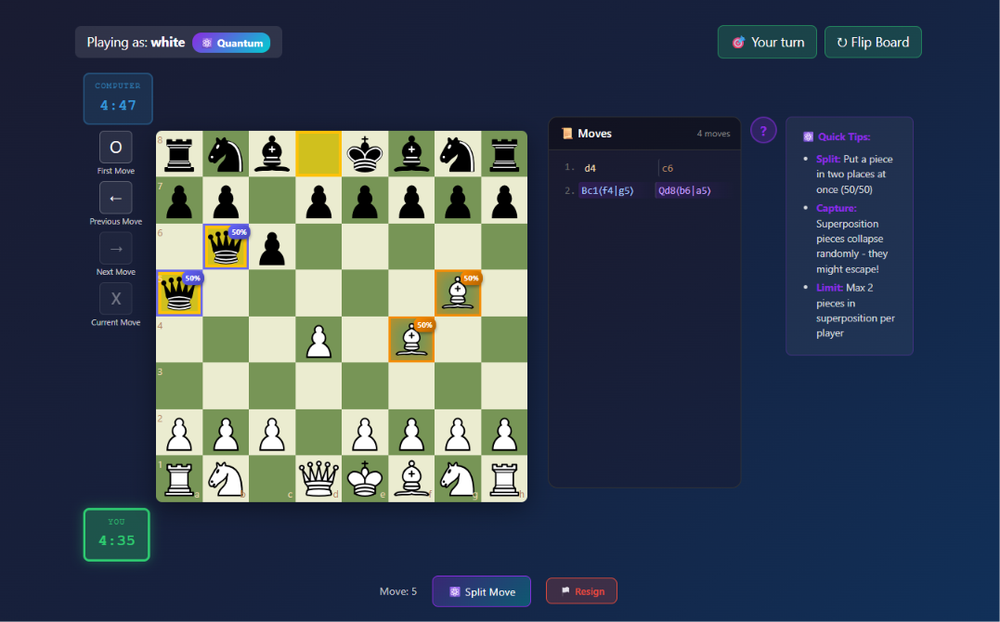

# ⚛️ Quantum Chess

**A chess variant where a piece can occupy two squares at once.**


Quantum Chess layers probabilistic superposition and measurement onto standard chess rules. Split an eligible piece across two legal destinations, then take your chances when an opponent tries to capture it.

## At a glance

- **Quantum split moves:** Queen, rook, bishop, and knight can enter a 50/50 superposition on two empty legal squares.
- **Quantum captures:** A capture attempt measures a superposed piece. It may be captured at the target square or escape to its other position.
- **Full chess rules:** Move legality and standard outcomes are powered by [`chess.js`](client/package.json), including castling, promotion, checkmate, and draws.
- **A playable local mode:** Play as White against a computer that selects a random legal classical or split action.
- **Multiplayer foundation:** A FastAPI signaling service and WebRTC data-channel client are present for peer-to-peer games.

## How quantum moves work

1. Select **Split Move**, choose an eligible piece, and choose two different empty squares that are both legal destinations.
2. The piece is represented at both destinations with 50% probability each. Each player can have up to the configured superposition limit (default: two pieces).
3. If a superposed piece is targeted, it collapses according to its position probabilities. The capture succeeds if it collapses onto the target; otherwise, it escapes to the other position.
4. Moving a superposed piece collapses it to the branch from which it moved. Kings and pawns cannot split.

The app also supports move history and navigation, clocks, board flipping, resignation, and game-end summaries.

## Project layout

```text
.
├── client/                 # React + TypeScript + Vite application
│   ├── src/
│   │   ├── components/     # Board, lobby, move list, rules, and game UI
│   │   ├── engine/         # Chess rules and quantum state transitions
│   │   ├── hooks/          # Game lifecycle, timers, computer opponent, toasts
│   │   └── networking/     # WebRTC connection and signaling client
│   ├── package.json
│   └── vercel.json
└── server/                 # FastAPI WebRTC signaling service
    ├── main.py
    ├── requirements.txt
    ├── Procfile
    └── render.yaml
```

### Architecture

- **Game engine —** [`ChessEngine.ts`](client/src/engine/ChessEngine.ts) keeps standard chess legality in `chess.js` and tracks quantum piece branches and probabilities alongside it. Move and collapse seeds support deterministic quantum captures between peers.
- **Game controller —** [`useChessGame.ts`](client/src/hooks/useChessGame.ts) manages game state, history, clocks, local computer turns, and the multiplayer room/message actions.
- **Interface —** [`App.tsx`](client/src/App.tsx) composes the board, move navigation, clocks, rules, notifications, and game-end flows. Components and styles live under `client/src/components/`.
- **Peer connection —** [`WebRTCConnection.ts`](client/src/networking/WebRTCConnection.ts) uses the signaling WebSocket to exchange WebRTC offers, answers, and ICE candidates; game messages are sent over a peer data channel.
- **Signaling service —** [`main.py`](server/main.py) creates and joins in-memory rooms, lists public waiting rooms, and relays signaling messages. It does not relay moves after the peer connection is established.

> **Current multiplayer UI status:** The lobby currently exposes the local computer game only. Although the networking hook, signaling server, and an open-games component are present, room creation/joining is not currently wired into the visible lobby.

## Run locally

### Frontend

Requirements: Node.js compatible with Vite 7 (Node.js 20.19+ or 22.12+) and npm.

```bash
cd client
npm ci
npm run dev
```

Open the local URL printed by Vite, then choose **Play Computer**.

Available client scripts:

| Command | Purpose |
| --- | --- |
| `npm run dev` | Start the Vite development server |
| `npm run build` | Create a production build in `client/dist/` |
| `npm run build:check` | Type-check and create a production build |
| `npm run typecheck` | Run the TypeScript project checks |
| `npm run lint` | Run ESLint |
| `npm run preview` | Preview the production build locally |

### Signaling server

Requirements: Python 3.12 is used by the Render deployment configuration.

```bash
cd server
python -m venv .venv
# Activate the virtual environment, then:
python -m pip install -r requirements.txt
uvicorn main:app --reload --port 8000
```

The server provides `GET /` for service information, `GET /api/health` for health checks, `POST /api/rooms` to create a room, `GET /api/rooms/open` to list public waiting rooms, `POST /api/rooms/join` to join a room, and `WS /ws/{room_id}` for WebRTC signaling.

## Server configuration

The signaling server reads these optional environment variables:

| Variable | Default | Description |
| --- | --- | --- |
| `ALLOWED_ORIGINS` | `*` | Allowed browser origins; provide comma-separated origins in production |
| `MAX_ROOMS` | `500` | Maximum number of in-memory rooms |
| `RATE_LIMIT_MAX` | `30` | Room creations allowed per IP within the limit window |
| `RATE_LIMIT_WINDOW` | `60` | Room-creation rate-limit window in seconds |
| `PORT` | Platform-provided | Listening port in the Render start command |

Room state is in memory, so rooms are lost when the service restarts and are not shared across multiple server instances. Stale rooms are cleaned up periodically. Use a specific `ALLOWED_ORIGINS` value when deploying the signaling service publicly.

## Deployment

- The frontend's Vercel configuration is in [`client/vercel.json`](client/vercel.json).
- The Python signaling service's Render configuration is in [`server/render.yaml`](server/render.yaml); [`server/Procfile`](server/Procfile) also defines its Uvicorn start command.

## Technology

- React 19, TypeScript, and Vite 7
- `chess.js` for standard chess rules
- `react-chessboard` for the interactive board
- Framer Motion for lobby animations
- FastAPI and Uvicorn for room management and WebSocket signaling
- WebRTC data channels for peer-to-peer game messages
